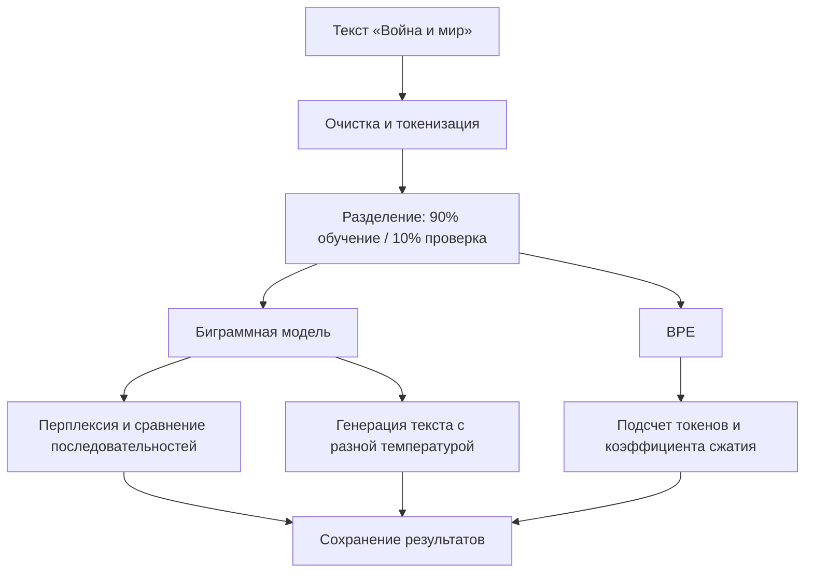

# Лабораторная работа № 1. Биграммная языковая модель и BPE

## Цель работы

Реализовать простую биграммную языковую модель для русского текста, изучить влияние сглаживания и температуры на генерацию, а также реализовать алгоритм Byte Pair Encoding (BPE) для разбиения слов на подсловные токены.

## Используемые данные

В качестве корпуса использован текст романа Л. Н. Толстого «Война и мир».

Перед обработкой текст приводится к нижнему регистру, буква «ё» заменяется на «е», затем из текста выделяются русские слова. Последние 10% последовательности слов используются как проверочная выборка, остальные 90% — для обучения.

| Показатель | Значение |
|---|---:|
| Всего слов | 433 082 |
| Обучающая выборка | 389 773 |
| Проверочная выборка | 43 309 |
| Размер словаря | 48 117 |

### 20 самых частотных слов

| Слово | Частота | Слово | Частота |
|---|---:|---|---:|
| и | 21 085 | я | 2 854 |
| в | 10 870 | она | 2 732 |
| не | 8 520 | но | 2 725 |
| что | 7 600 | все | 2 674 |
| он | 7 395 | было | 2 501 |
| на | 6 665 | это | 2 434 |
| с | 5 861 | то | 2 261 |
| как | 4 011 | сказал | 2 000 |
| его | 3 895 | так | 1 954 |
| к | 3 428 | о | 1 832 |

## Ход работы

### 1. Биграммная языковая модель

Биграммная модель оценивает вероятность следующего слова только по предыдущему слову. Для обучения подсчитываются частоты отдельных слов и соседних пар слов.

Для устранения нулевых вероятностей используется аддитивное сглаживание Лапласа:

\[
P(w_i \mid w_{i-1}) =
\frac{C(w_{i-1},w_i)+\alpha}
{C(w_{i-1})+\alpha V},
\]

где:
- \(C(w_{i-1},w_i)\) — количество появлений биграммы;
- \(C(w_{i-1})\) — количество появлений предыдущего слова;
- \(V\) — размер словаря;
- \(\alpha\) — параметр сглаживания.

Реализованы обучение модели, вычисление вероятности и логарифмической вероятности последовательности, а также генерация текста.

### 2. Сравнение параметров сглаживания

Перплексия вычислялась на проверочной выборке. Чем ниже значение, тем лучше модель предсказывает последовательность слов на этих данных.

| Параметр α | Перплексия |
|---:|---:|
| 1 | 16 687,6 |
| 0,1 | 8 142,4 |
| 0,01 | **5 511,3** |

Среди проверенных значений лучший результат получен при \(\alpha=0{,}01\). Уменьшение параметра сглаживания в данном эксперименте снизило перплексию.

### 3. Проверка связности последовательности

Для сравнения взято предложение из проверочной выборки и набор тех же слов, перемешанных в случайном порядке. Использовалось значение \(\alpha=0{,}01\).

| Последовательность | Логарифмическая вероятность |
|---|---:|
| Исходная | −83,51 |
| Перемешанная | −127,19 |

Исходная последовательность получила более высокую логарифмическую вероятность (значение ближе к нулю), чем перемешанная. Это показывает, что модель учитывает локальные связи между соседними словами. При этом в исходной последовательности встретилось 5 незнакомых биграмм, для которых сглаживание позволило получить ненулевые вероятности.

### 4. Генерация текста и температура

Генерация выполнялась с начальными словами «князь» и «она», по 30 слов, при температурах 0,5, 1 и 2. Для воспроизводимости использовалось фиксированное начальное значение генератора случайных чисел (seed = 42).

Температура влияет на распределение вероятностей:
- **T = 0,5** — модель чаще выбирает наиболее вероятные продолжения, поэтому текст получается более предсказуемым;
- **T = 1** — используется исходное распределение вероятностей;
- **T = 2** — распределение становится более равномерным, возрастает разнообразие и случайность продолжений.

Примеры полученной генерации:

**T = 0,5, начало «князь»:**

> князь андрей не было он с тем чтобы не было в москве и с ним разговор и не мог удержаться чтобы в темноте ночи не говорили что он не был

**T = 1, начало «она»:**

> она такая же как будто желая более что они прошли обыкновенно говоривший мастеровой замолчал и лохматый унтер-офицер взяв ее ожидало он сидел делал наполеон тот илья андреич князь долгоруков неправда

Полученные тексты демонстрируют работу вероятностной генерации. Они не всегда грамматически и смыслово связны, поскольку биграммная модель учитывает только одно предыдущее слово.

### 5. Алгоритм Byte Pair Encoding (BPE)

BPE используется для разбиения слов на подсловные единицы. Изначально слово представляется последовательностью символов с маркером конца слова `</w>`. Затем алгоритм многократно находит наиболее частую соседнюю пару символов и объединяет её в новый токен.

В эксперименте:
- редкие слова с частотой менее 3 не использовались при обучении слияний;
- выполнено 1 500 слияний;
- при кодировании применяются изученные слияния в порядке их ранга.

Результаты:

| Показатель | Значение |
|---|---:|
| Количество слияний | 1 500 |
| Размер BPE-словаря | 1 534 |
| Среднее количество токенов на слово | 1,930 |
| Коэффициент сжатия | 2,69 раза |

Примеры разбиения:

| Слово | Результат BPE |
|---|---|
| наполеон | `наполеон</w>` |
| сказала | `сказала</w>` |
| неудовольствие | `не` + `удов` + `оль` + `ствие</w>` |

Часто встречающиеся слова могут сохраняться одним токеном, а менее частотные или сложные слова разбиваются на несколько частей.

## Схема выполнения эксперимента



## Выводы

В ходе лабораторной работы реализованы биграммная языковая модель и алгоритм BPE, проведены эксперименты на корпусе «Война и мир».

1. Биграммная модель научилась учитывать статистику соседних слов. Исходная последовательность получила более высокую логарифмическую вероятность, чем перемешанная.
2. Из проверенных значений сглаживания наименьшая перплексия получена при \(\alpha=0{,}01\).
3. Температура влияет на характер генерации: при низкой температуре продолжения более предсказуемы, при высокой — более разнообразны.
4. Ограничение биграммной модели заключается в том, что она учитывает только одно предыдущее слово и поэтому не способна полноценно моделировать дальние зависимости и смысл текста.
5. BPE позволил представить корпус в виде подсловных токенов. При 1 500 слияниях среднее количество токенов составило 1,930 на слово, а коэффициент сжатия — 2,69 раза.

## Файлы проекта

- `run.py` — код реализации и проведения экспериментов.
- `artifacts/bigram.json` — статистика корпуса, метрики биграммной модели и примеры генерации.
- `artifacts/bpe.json` — результаты обучения BPE, список слияний и примеры токенизации.

## Запуск

Из корневой папки репозитория выполните:

```bash
python pt01/run.py
```

Скрипт загружает исходный корпус при необходимости и сохраняет результаты в папку `pt01/artifacts/`.
